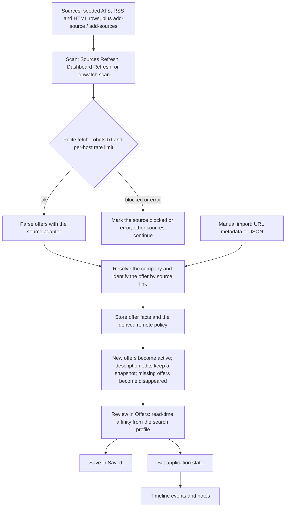

# JobWatch

JobWatch is a local, single-user web application that tracks job offers
during one job search. It is aimed at a full-remote Platform Engineer /
SRE search in France. It scans ATS boards (Greenhouse, Lever, Ashby,
Personio, Workable, BambooHR), Welcome to the Jungle company pages,
RSS/Atom feeds and CSS-selector career pages, and records new, updated
and disappeared offers. Classification is
deterministic and rule-based — there is no LLM in the scan loop — and
offers, states, timeline events, notes and description versions all live
in one SQLite file. The server binds to localhost, honors `robots.txt`,
rate-limits each host, and ships as a single Go binary with the React UI
embedded.

## Requirements

- Go 1.27 or newer. SQLite is a pure-Go driver compiled into the binary,
  so there is no C dependency and no separate database server.
- Node.js 20+ with npm, only to build the web UI.
- Linux (developed on WSL2 / Ubuntu 24.04); other platforms should work.
- No Docker, external services or config file are required.

## Quick start

```sh
git clone https://github.com/stepbeta/jobwatch.git
cd jobwatch

# Build the React UI and embed it in the binary.
cd web
npm ci
npm run build
cd ..
go build -tags ui -o jobwatch ./cmd/jobwatch

# Start the server. The SQLite database is created on first use.
./jobwatch serve
# → http://127.0.0.1:8080
```

`web/dist` is a build artifact (gitignored). Plain `go build ./...` works
without it and serves a placeholder page; `-tags ui` requires
`npm run build` first. For API-only work:

```sh
go build -o jobwatch ./cmd/jobwatch
```

To embed a version string:

```sh
go build -tags ui -ldflags "-X main.version=0.2.0" -o jobwatch ./cmd/jobwatch
```

### Add sources and scan

A fresh database already contains the 71 sources decided in Milestones
5a/5b/6a/10a: 39 enabled ATS/RSS/HTML/WTTJ sources and 32 disabled rows
with a note. Add your own, then scan headlessly (or use the UI):

```sh
./jobwatch add-source https://boards.greenhouse.io/gitlab --name GitLab
./jobwatch add-source https://www.welcometothejungle.com/en/companies/fabriq/jobs --name Fabriq

./jobwatch scan          # headless scan of all enabled sources
./jobwatch list          # ID, company, title, location, remote, acceptance, affinity, states
```

To register a whole file of bookmarks, use
`./jobwatch add-sources <file>` (see
[docs/USAGE.md](docs/USAGE.md#bulk-source-registration)). Or open
`http://127.0.0.1:8080`, go to **Sources** and click **Refresh all**. The
database defaults to `./jobwatch.db`; use the global `--db <path>` flag to
choose another file.

## Core workflow

1. **Configure sources.** Use the seeded rows, add an ATS board with
   `add-source`, register a bookmark list with `add-sources`, or define
   an RSS/HTML source with its mapping or selectors.
2. **Scan.** Scans are manual: **Sources → Refresh all**, the
   Applications Refresh on the dashboard, or `jobwatch scan`. Each source
   is fetched politely, parsed by its adapter, and written in one
   transaction. A failing source is marked `error` or `blocked` without
   stopping the others. An item missing a company or title is kept as an
   incomplete offer (reported in the scan summary) and hidden from the
   lists until it is repaired.
3. **Classify and review.** A sighting stores offer facts and a derived
   remote policy. Title and location affinity are computed when an offer
   is read, from the editable **Search profile**, so a profile change
   applies immediately. Offers are identified by their source link
   (external uid, then URL); a description edit keeps a new snapshot, and
   offers that disappear are marked `disappeared`, never deleted. The
   **Offers** page filters and sorts by state, remote policy, remote
   acceptance and both affinities.
4. **Save and apply.** Set the offer's application state to `saved` to
   shortlist it, then move it to `applied` and keep its timeline events
   and notes on the offer detail page.



## Commands

| Command | Description |
|---|---|
| `serve [--port 8080] [--addr 127.0.0.1]` | Start the local server: REST API under `/api` and the SPA at `/` |
| `scan [all\|<source-id>]` | Scan all enabled sources (default) or one source by ID |
| `add-source <url>` | Register a source; ATS board URLs are detected automatically |
| `add-sources <file>` | Register every recognized URL in a file |
| `list` | Print offers, remote acceptance and affinity; `--sources` lists sources instead |
| `import <url \| json \| file.json \| ->` | Add an offer seen elsewhere |
| `reattribute [--all \| --source <id>]` | Re-fetch a source and move offers matched by `(source, uid)` to the company and title the adapter now reports, preserving history |
| `backup <dest>` | Write and validate a consistent copy of the database |

All commands accept `--db <path>` (default `./jobwatch.db`). Run
`./jobwatch <command> --help` for the exact flags; the full command
reference is in [docs/USAGE.md](docs/USAGE.md#command-reference).

## Web UI

- **Dashboard** (`#/`) — Applications (offers with an application state
  other than `none` or `saved`, most recent timeline activity first) and
  Saved (offers in the `saved` state).
- **Offers** (`#/offers`) — the full filterable, sortable table with title
  and location affinity badges, a remote policy badge, a searchable
  company filter, persisted column picker, per-page selector, URL-restored
  filters (including minimum affinity and remote acceptance), and the
  **Add offer** import dialog.
- **Incomplete** (`#/incomplete`) — items a source could not normalize,
  with the item count, the reported values and a repair form that assigns
  a company and title while keeping the source link and history.
- **Sources** — enable/disable switch, filters, scan status, selectable
  rows with bulk refresh/delete, icon row actions, Refresh all, and
  add/edit in a modal with type-dependent config fields.
- **Offer detail** — two-column identity/provenance header with title and
  location affinity badges, the remote policy badge and its profile
  acceptance, timeline, notes and a single-version description browser with
  Scan/Manual origin and diffs.
- **Company detail** — identity and company notes in one two-column
  header, a searchable/sortable/paginated offers panel below, and an
  explicit possible-duplicate merge prompt.
- **Interview prep** (`#/interview-prep`) — a personal FAQ of anticipated
  interview questions grouped into draggable category sections, with
  markdown answers and an Edit/View editor.
- **Search profile** (`#/search-profile`) — the target role, geography and
  accepted remote policies: term weights in a 3/5 bucket scale, advanced
  description terms, and explanatory text. Affinity is recomputed from
  the profile on every read; no reclassification command exists.

The header **Theme** control offers **System**, **Light** and **Dark**.
**System** is the default and follows the operating system; the choice is
remembered across reloads and applied before the first paint.

Page-by-page behavior and the saved-state semantics are in
[docs/USAGE.md](docs/USAGE.md#web-ui).

## Reference

- **Sources and configuration** — supported source types, recognized
  board URLs, every `--config` key, bulk registration and the per-URL
  source decisions: [docs/USAGE.md](docs/USAGE.md#sources).
- **Manual import** — URL metadata extraction, JSON input and the
  aggregator workflow: [docs/USAGE.md](docs/USAGE.md#manual-import).
- **States, classification and search profiles** — offer and application
  states, the facts/preferences/read-time-score model and the profile
  editor: [docs/USAGE.md](docs/USAGE.md#offer-and-application-states) and
  [docs/USAGE.md](docs/USAGE.md#classification-and-search-profiles).
- **REST API** — endpoints, parameters, response shapes and error codes:
  [docs/API.md](docs/API.md). Errors use
  `{"error":{"code":"...","message":"..."}}`; `GET /api/health` is the
  liveness check.
- **Backups** — a validated copy that is safe while `serve` runs:
  [docs/USAGE.md](docs/USAGE.md#backups).
- **Architecture and data model** — components, adapters, scan pipeline
  and tables: [docs/ARCHITECTURE.md](docs/ARCHITECTURE.md) and
  [docs/DATA-MODEL.md](docs/DATA-MODEL.md).

## Development

```sh
go build ./... && go vet ./... && go test ./...
cd web && npm run build        # type-check + production bundle
cd web && npm test             # component tests (Vitest + jsdom)
```

A root `Makefile` wraps the full UI-embedded build:

```sh
make ui       # cd web && npm ci && npm run build
make build    # make ui, then go build -tags ui -o jobwatch ./cmd/jobwatch
make serve    # make build, then ./jobwatch serve
```

Two processes for UI work:

```sh
./jobwatch serve                 # API on 127.0.0.1:8080
cd web && npm install && npm run dev
# open http://127.0.0.1:5173 — Vite proxies /api to the Go server
```

Tests use recorded fixtures (`internal/sources/testdata`) and never hit
the network. The API integration tests use a temporary SQLite file per
handler group. The documented smoke flow runs with
`go test ./internal/api -run TestSmokeFlows -v`; manual UI steps are in
[docs/SMOKE-TEST.md](docs/SMOKE-TEST.md).

## Documentation

- [docs/USAGE.md](docs/USAGE.md): sources, config, web UI, import, states, CLI, backups
- [docs/SPEC.md](docs/SPEC.md): product specification (source of truth)
- [docs/ARCHITECTURE.md](docs/ARCHITECTURE.md): components and data flow
- [docs/DATA-MODEL.md](docs/DATA-MODEL.md): tables, fingerprints, state machines
- [docs/API.md](docs/API.md): REST endpoints
- [docs/MILESTONES.md](docs/MILESTONES.md): progress, deviations, known gaps
- [docs/SMOKE-TEST.md](docs/SMOKE-TEST.md): automated and manual smoke-test steps
- [docs/SOURCE-DECISIONS.md](docs/SOURCE-DECISIONS.md): per-URL source decisions
- [CHANGELOG.md](CHANGELOG.md): session-by-session changes

## Status

Milestones 1–11 are complete, including the Milestone 8 documentation pass
that restructured this README and added `docs/USAGE.md`. The binary
scans, classifies and serves the UI and API end to end; Milestone 9 adds
the personal interview-prep FAQ, Milestone 10 its categories,
drag-and-drop ordering and Edit/View answer dialog, and Milestone 11 the
shared table controls, sources bulk actions and two-column offer header.
Known gaps and deliberate limitations are listed in
[docs/MILESTONES.md](docs/MILESTONES.md#known-gaps-current).
