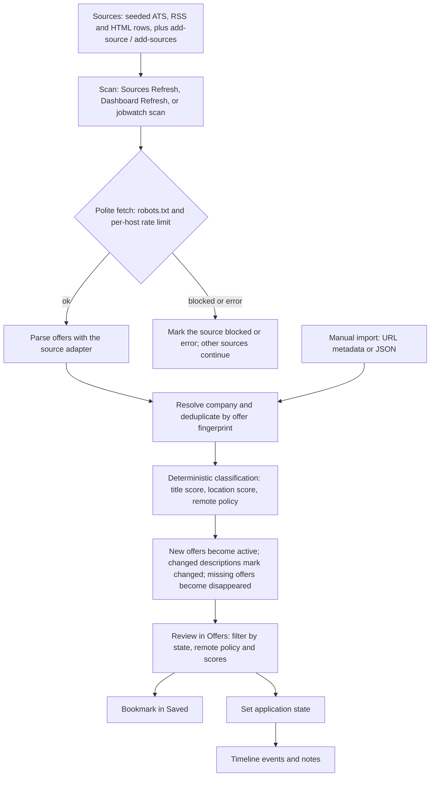

# JobWatch

JobWatch is a local, single-user web application that tracks job offers
during one job search. It is aimed at a full-remote Platform Engineer /
SRE search in France. It scans ATS boards (Greenhouse, Lever, Ashby,
Personio, Workable, BambooHR), RSS/Atom feeds and CSS-selector career
pages, and records new, changed and disappeared offers. Classification is
deterministic and rule-based — there is no LLM in the scan loop — and
offers, states, timeline events, notes and description versions all live
in one SQLite file. The server binds to localhost, honors `robots.txt`,
rate-limits each host, and ships as a single Go binary with the React UI
embedded.

## Requirements

- Go 1.27 or newer. SQLite is a pure-Go driver compiled into the binary,
  so there is no C dependency and no separate database server.
- Node.js 20+ with npm, only to build the web UI.
- Linux (developed on WSL2 / Ubuntu 24.04); other platforms should work.
- No Docker, external services or config file are required.

## Quick start

```sh
git clone https://github.com/stepbeta/jobwatch.git
cd jobwatch

# Build the React UI and embed it in the binary.
cd web
npm ci
npm run build
cd ..
go build -tags ui -o jobwatch ./cmd/jobwatch

# Start the server. The SQLite database is created on first use.
./jobwatch serve
# → http://127.0.0.1:8080
```

`web/dist` is a build artifact (gitignored). Plain `go build ./...` works
without it and serves a placeholder page; `-tags ui` requires
`npm run build` first. For API-only work:

```sh
go build -o jobwatch ./cmd/jobwatch
```

To embed a version string:

```sh
go build -tags ui -ldflags "-X main.version=0.2.0" -o jobwatch ./cmd/jobwatch
```

### Add sources and scan

A fresh database already contains the 70 sources decided in Milestones
5a/5b/6a: 38 enabled ATS/RSS/HTML sources and 32 disabled rows with a
note. Add your own, then scan headlessly (or use the UI):

```sh
./jobwatch add-source https://boards.greenhouse.io/gitlab --name GitLab

./jobwatch scan          # headless scan of all enabled sources
./jobwatch list          # ID, company, title, location, remote, scores, states
```

To register a whole file of bookmarks, use
`./jobwatch add-sources <file>` (see
[docs/USAGE.md](docs/USAGE.md#bulk-source-registration)). Or open
`http://127.0.0.1:8080`, go to **Sources** and click **Refresh all**. The
database defaults to `./jobwatch.db`; use the global `--db <path>` flag to
choose another file.

## Core workflow

1. **Configure sources.** Use the seeded rows, add an ATS board with
   `add-source`, register a bookmark list with `add-sources`, or define
   an RSS/HTML source with its mapping or selectors.
2. **Scan.** Scans are manual: **Sources → Refresh all**, the
   Applications Refresh on the dashboard, or `jobwatch scan`. Each source
   is fetched politely, parsed by its adapter, and written in one
   transaction. A failing source is marked `error` or `blocked` without
   stopping the others.
3. **Classify and review.** Every sighting gets a title score, a location
   score and a derived remote policy. Offers are deduplicated by company
   and fingerprint; changed descriptions keep a new snapshot, and offers
   that disappear are marked `disappeared`, never deleted. The **Offers**
   page filters and sorts by state, remote policy and both scores.
4. **Bookmark and apply.** The star is a personal bookmark, independent
   of application state. Set an application state on the offer, then keep
   its timeline events and notes on the offer detail page.



## Commands

| Command | Description |
|---|---|
| `serve [--port 8080] [--addr 127.0.0.1]` | Start the local server: REST API under `/api` and the SPA at `/` |
| `scan [all\|<source-id>]` | Scan all enabled sources (default) or one source by ID |
| `add-source <url>` | Register a source; ATS board URLs are detected automatically |
| `add-sources <file>` | Register every recognized URL in a file |
| `list` | Print offers and states; `--sources` lists sources instead |
| `import <url \| json \| file.json \| ->` | Add an offer seen elsewhere |
| `reclassify [--all]` | Backfill or recompute classifier scores |
| `backup <dest>` | Write and validate a consistent copy of the database |

All commands accept `--db <path>` (default `./jobwatch.db`). Run
`./jobwatch <command> --help` for the exact flags; the full command
reference is in [docs/USAGE.md](docs/USAGE.md#command-reference).

## Web UI

- **Dashboard** (`#/`) — Applications (offers with an application state
  other than `todo`, most recent timeline activity first) and Saved
  (bookmarked offers).
- **Offers** (`#/offers`) — the full filterable, sortable table with score
  badges, a bookmark toggle on every row, and the **Add offer** import
  dialog.
- **Sources** — enable/disable, scan status, per-source Refresh, Refresh
  all, and add/edit in a modal with type-dependent config fields.
- **Offer detail** — states, provenance, timeline, notes and a
  single-version description browser with Scan/Manual origin and diffs.
- **Company detail** — identity and company notes in one two-column
  header, offers below, and an explicit possible-duplicate merge prompt.

Page-by-page behavior and the bookmark semantics are in
[docs/USAGE.md](docs/USAGE.md#web-ui).

## Reference

- **Sources and configuration** — supported source types, recognized
  board URLs, every `--config` key, bulk registration and the per-URL
  source decisions: [docs/USAGE.md](docs/USAGE.md#sources).
- **Manual import** — URL metadata extraction, JSON input and the
  aggregator workflow: [docs/USAGE.md](docs/USAGE.md#manual-import).
- **States and classification** — offer and application states, and the
  deterministic scoring rules: [docs/USAGE.md](docs/USAGE.md#offer-and-application-states)
  and [docs/USAGE.md](docs/USAGE.md#classification).
- **REST API** — endpoints, parameters, response shapes and error codes:
  [docs/API.md](docs/API.md). Errors use
  `{"error":{"code":"...","message":"..."}}`; `GET /api/health` is the
  liveness check.
- **Backups** — a validated copy that is safe while `serve` runs:
  [docs/USAGE.md](docs/USAGE.md#backups).
- **Architecture and data model** — components, adapters, scan pipeline
  and tables: [docs/ARCHITECTURE.md](docs/ARCHITECTURE.md) and
  [docs/DATA-MODEL.md](docs/DATA-MODEL.md).

## Development

```sh
go build ./... && go vet ./... && go test ./...
cd web && npm run build        # type-check + production bundle
cd web && npm test             # component tests (Vitest + jsdom)
```

Two processes for UI work:

```sh
./jobwatch serve                 # API on 127.0.0.1:8080
cd web && npm install && npm run dev
# open http://127.0.0.1:5173 — Vite proxies /api to the Go server
```

Tests use recorded fixtures (`internal/sources/testdata`) and never hit
the network. The API integration tests use a temporary SQLite file per
handler group. The documented smoke flow runs with
`go test ./internal/api -run TestSmokeFlows -v`; manual UI steps are in
[docs/SMOKE-TEST.md](docs/SMOKE-TEST.md).

## Documentation

- [docs/USAGE.md](docs/USAGE.md): sources, config, web UI, import, states, CLI, backups
- [docs/SPEC.md](docs/SPEC.md): product specification (source of truth)
- [docs/ARCHITECTURE.md](docs/ARCHITECTURE.md): components and data flow
- [docs/DATA-MODEL.md](docs/DATA-MODEL.md): tables, fingerprints, state machines
- [docs/API.md](docs/API.md): REST endpoints
- [docs/MILESTONES.md](docs/MILESTONES.md): progress, deviations, known gaps
- [docs/SMOKE-TEST.md](docs/SMOKE-TEST.md): automated and manual smoke-test steps
- [docs/SOURCE-DECISIONS.md](docs/SOURCE-DECISIONS.md): per-URL source decisions
- [CHANGELOG.md](CHANGELOG.md): session-by-session changes

## Status

Milestones 1–7f are complete, and Milestone 8 is the documentation pass
recorded here: it restructures this README and adds `docs/USAGE.md`; no
behavior, schema or API changed. The binary scans, classifies and serves
the UI and API end to end. Known gaps and deliberate limitations are
listed in [docs/MILESTONES.md](docs/MILESTONES.md#known-gaps-current).
